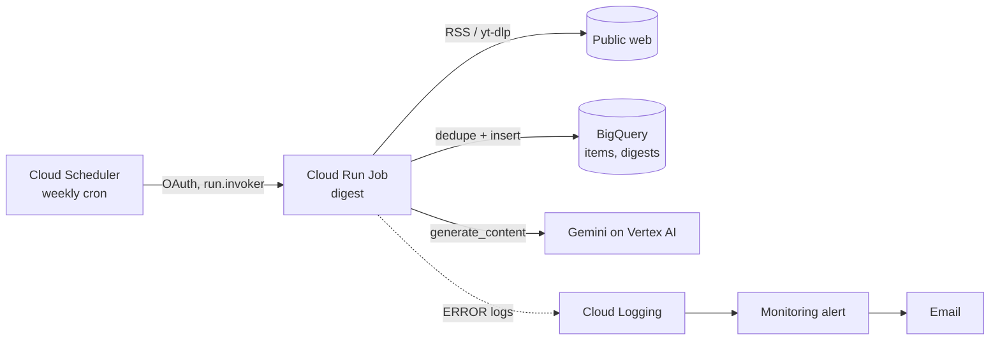

# Cloud Digest: scheduled research job on Google Cloud

A small, fully Terraform-managed pipeline that collects tech news and videos once a week, stores them in BigQuery and writes a Gemini digest. It is a worked example of running Agent Reach-style collection as a serverless job instead of from a laptop.



## Design decisions

| Decision | Why |
|---|---|
| Cloud Run **Job**, not Service | Batch work, no HTTP surface, scales to zero, billed per execution. |
| Two service accounts | The job can write to one dataset, run queries and call Gemini. The scheduler can only invoke this one job. |
| Dataset-level IAM for BigQuery | `dataEditor` on the dataset only, plus `jobUser` at project level (required to run queries). |
| Sources without login | Reddit and Twitter need a logged-in session, which a headless job lacks. RSS and YouTube search via `yt-dlp` work unauthenticated. |
| Dedupe before insert | Query existing IDs (hash of URL), insert only new rows, so reruns are idempotent. |
| Non-zero exit on failure | Any exception fails the execution and logs ERROR, which triggers the alert. |
| Pinned dependencies | `requirements.txt` pins exact versions. Bump them deliberately. |

## Deploy

Requires `gcloud`, `terraform >= 1.9` and a project with billing enabled.

```bash
cd examples/cloud-digest/terraform
cp terraform.tfvars.example terraform.tfvars   # edit project_id, alert_email

# 1. Create APIs, registry, BigQuery, service accounts (no job yet: image is empty)
terraform init && terraform apply

# 2. Build and push the image
REPO=$(terraform output -raw image_repository)
gcloud builds submit .. --tag "$REPO/digest:latest" --project <project_id>

# 3. Create the job and the schedule
terraform apply -var image="$REPO/digest:latest"

# 4. Run once now and read the result
gcloud run jobs execute digest --region europe-west3 --wait
bq query --use_legacy_sql=false \
  'SELECT run_at, item_count, digest FROM agent_reach_digest.digests ORDER BY run_at DESC LIMIT 1'
```

Tear down with `terraform destroy` (tables and the job are unprotected by default, see `deletion_protection`).

## Local checks

```bash
pip install -r requirements.txt pytest
python -m pytest tests -q
terraform -chdir=terraform fmt -check && terraform -chdir=terraform init -backend=false && terraform -chdir=terraform validate
```

`terraform validate` and the unit tests were run for this scaffold. It has **not** been deployed to a real project yet, so do step 4 and fix whatever it shows before putting it on a CV.

## Cost

Expected to be pennies per month: one short run per week, a few KB in BigQuery, a few cents of Gemini tokens, and the Cloud Run, Scheduler and BigQuery free tiers. Artifact Registry storage is the one recurring line item, limited by the cleanup policy. Check the [pricing calculator](https://cloud.google.com/products/calculator) with your region and set a billing budget before you deploy.

## Next steps (portfolio value)

- Add a billing budget and a Cloud Monitoring dashboard for run duration and failures.
- Move state to remote Terraform backend (GCS) and add a GitHub Actions workflow with Workload Identity Federation instead of keys.
- Add a `Looker Studio` view over `items` and `digests`.
- Replace the digest prompt with an ADK agent that decides which items deserve a transcript fetch.
